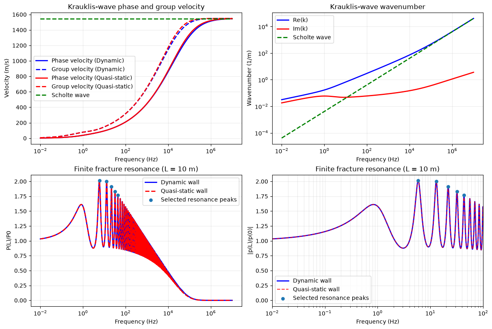

# A-simple-test-of-krauklis-wave
Krauklis-wave dispersion relation, finite-fracture resonance

## Numerical Results

  

  <em>Figure 1. Dispersion and resonance characteristics of Krauklis waves.</em>

